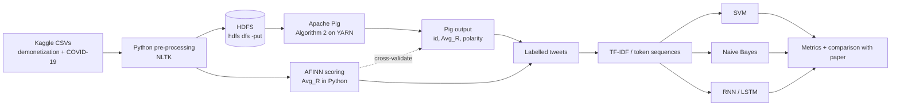
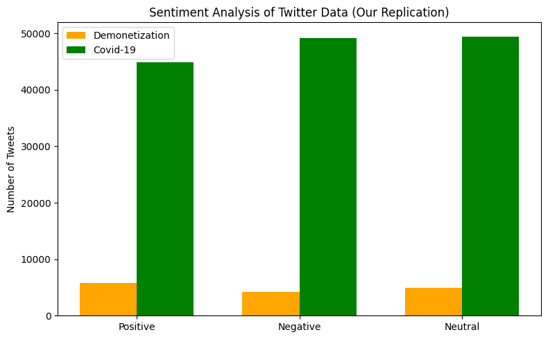
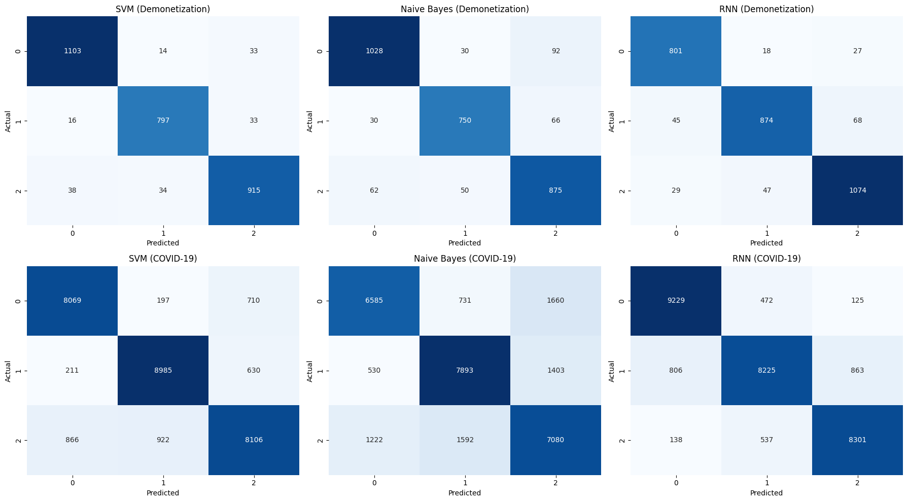
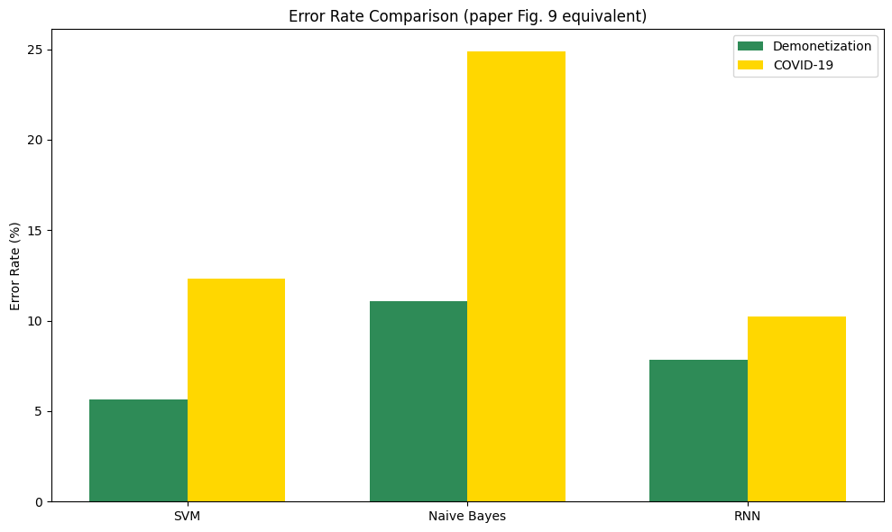
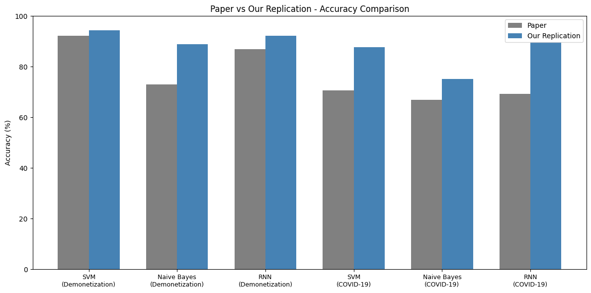

# Hadoop-Based Twitter Sentiment Analysis: A Full Replication

Replication of **"Apache Hadoop based effective sentiment analysis on demonetization and covid-19 tweets"**
S. Anitha and M. Metilda, *Global Transitions Proceedings* 3 (2022) 338-342, [doi:10.1016/j.gltp.2022.03.021](https://doi.org/10.1016/j.gltp.2022.03.021)

Big Data Analytics and NLP course project, B.Tech (AI & Data Science), SVKM's NMIMS (MPSTME), Indore.
Author: **Vedansh Tiwari**

   

---

## 1. TL;DR

| | |
|---|---|
| **Goal** | Reproduce the paper's pipeline: tweets -> pre-processing -> Apache Pig sentiment labelling on HDFS -> SVM / Naive Bayes / RNN comparison |
| **Datasets** | Demonetization tweets (14,912 after cleaning) and COVID-19 tweets (143,480), both from Kaggle |
| **Big Data part** | Algorithm 2 (TSA) written in Pig Latin and run on YARN in a Cloudera QuickStart VM |
| **Best result** | Demonetization: SVM **94.37%**. COVID-19: RNN **89.75%** (agreement with lexicon labels, see Section 8) |
| **Pig vs Python** | On the full demonetization set the Pig output matches the Python computation **exactly** |
| **Honest caveat** | Only 60,000 of 143,480 COVID-19 tweets went through Pig (single-node VM instability). The rest used the identical Python implementation |

Everything needed to understand and redo the work is in this README. The full write-up is in [`docs/Project_Report.docx`](docs/Project_Report.docx) and the screenshot proof of the Hadoop run is in [`docs/Cloudera_Hadoop_Evidence.docx`](docs/Cloudera_Hadoop_Evidence.docx).

---

## 2. The Paper in One Minute

The paper argues that Hadoop is a good fit for Twitter sentiment analysis because tweets are large in volume and unstructured. Its workflow:

1. Collect tweets (Apache Flume) and store them in **HDFS**.
2. Pre-process: tokenization, stemming, case conversion, punctuation removal, stop-word removal.
3. Run the **Twitter Sentiment Analysis (TSA) algorithm** in **Apache Pig**: look up every word in a sentiment dictionary, compute

   `Avg_R = (sum of word rates) / (number of words in the tweet)`

   and label the tweet positive / negative / neutral from `Avg_R`.
4. Feed the labelled data to **SVM, Naive Bayes and RNN** and compare accuracy, precision, recall, F-measure, ROC and error rate.

---

## 3. Pipeline Implemented Here



---

## 4. Environment

| Component | Version / detail |
|---|---|
| Big data VM | Cloudera QuickStart VM 5.13.0 (CDH 5.13.0), VirtualBox, single node |
| Pig | 0.12.0-cdh5.13.0 (MapReduce on YARN) |
| HDFS | 54.46 GB configured, healthy (0 missing, 0 corrupt, 0 under-replicated blocks) |
| File transfer | VirtualBox shared folder between Windows host and the VM |
| Python | 3.10 |
| Libraries | pandas, numpy, matplotlib, seaborn, wordcloud, nltk, afinn, scikit-learn, tensorflow/keras (see `requirements.txt`) |

---

## 5. Datasets

| Dataset | Source | Rows used | Notes |
|---|---|---|---|
| Demonetization tweets | Kaggle (`demonetization-tweets.csv`) | 14,912 after removing empty tweets post-cleaning | Paper reports 14,940 instances |
| COVID-19 tweets | Kaggle (`Covid-19 Twitter Dataset (Apr-Jun 2020).csv`) | 143,480 (143,479 after dropping one empty record for ML) | Paper says Jan-May 2020; the Kaggle file used here covers Apr-Jun 2020 |

Raw data is **not** committed (see `.gitignore`). Download both files from Kaggle yourself.

---

## 6. Method in Detail

### 6.1 Pre-processing (matches the paper's five steps)

| Step | What is done |
|---|---|
| Noise removal | Remove leading `RT`, URLs, `@mentions`, `&amp;`; keep hashtag word, drop `#` |
| Case conversion | Lower-case |
| Punctuation removal | Keep only `a-z`, `0-9`, whitespace |
| Tokenization | Whitespace split |
| Stop-word removal | NLTK English list; tokens of length 1 dropped |
| Stemming | Porter stemmer |

Two versions of the text are kept:

- **Stemmed text** is used as classifier input.
- **Unstemmed text** is used for AFINN scoring. The dictionary contains full word forms, and stemming breaks lookups (for example "clearly" becomes "clearli").

Example:

```
BEFORE: RT @Hemant_80: Did you vote on #Demonetization on Modi survey app?
AFTER : vote demonet modi survey app
```

### 6.2 Sentiment labelling: Algorithm 2 (TSA)

The paper does not name its dictionary. This replication uses **AFINN** (3,382 words, integer rates from -5 to +5), exported to `afinn_dictionary.csv` as `word,rate`.

Pig logic (mirrors the paper's Table 2):

1. Load tweets (`id`, text) and the dictionary (`word`, `rate`).
2. Tokenize each tweet into words.
3. Join tokens with the dictionary; words not in the dictionary count as rate 0.
4. Group by tweet id and compute `Avg_R`.
5. Assign polarity.

**Correction to the paper.** The paper's pseudo-code says positive if `Avg_R >= 0`. That makes the "neutral" branch unreachable. A literal run produced only two classes (demonetization: 10,853 positive / 4,059 negative). The rule used here is:

| Condition | Label |
|---|---|
| `Avg_R > 0` | positive |
| `Avg_R < 0` | negative |
| `Avg_R = 0` | neutral (no dictionary word matched, or exactly balanced) |

### 6.3 Classification setup

| Item | Choice | Why |
|---|---|---|
| Features (SVM, NB) | TF-IDF, 5,000 features | Paper does not specify |
| Split | Stratified 80/20, `random_state=42` | Paper reports 10-fold CV, not replicated (see Section 9) |
| SVM | `LinearSVC` | |
| Naive Bayes | `MultinomialNB` | |
| RNN | Embedding(10,000 x 64) -> LSTM(64, dropout 0.2) -> Dense(32, ReLU) -> Dropout(0.3) -> Dense(3, softmax) | Paper does not specify architecture |
| RNN training | Adam, categorical cross-entropy, max length 30, up to 15 epochs, early stopping (patience 2) | |
| Metrics | Accuracy, weighted precision, recall, F1, confusion matrix, error rate, training time | |

---

## 7. Results

### 7.1 Sentiment label distribution (cf. paper Fig. 3)

| Dataset | Positive | Negative | Neutral |
|---|---|---|---|
| Demonetization (14,912) | 5,751 | 4,228 | 4,933 |
| COVID-19 (143,480) | 44,881 | 49,131 | 49,468 |



### 7.2 Big Data (Hadoop / Pig) outcomes

| Check | Outcome |
|---|---|
| Pig version | 0.12.0-cdh5.13.0 verified |
| HDFS health | Healthy, no missing / corrupt blocks |
| Demonetization on Pig | MapReduce job on YARN finished `SUCCEEDED`, 14,912 classified records |
| **Pig vs Python** | **Exact match**: 4,228 negative, 4,933 neutral, 5,751 positive |
| COVID-19 on Pig | 60,000 of 143,480 tweets (about 42%) processed in chunks, e.g. a 30,000-tweet chunk `SUCCEEDED` |
| COVID-19 remainder | Same algorithm in Python (VM repeatedly unstable on the larger input) |

Screenshots for each step (Cloudera Manager, `pig -version`, `hdfs dfsadmin -report`, `hdfs dfs -put`, the Pig script, YARN job, output retrieval, cross-validation, `hdfs fsck`) are in [`docs/Cloudera_Hadoop_Evidence.docx`](docs/Cloudera_Hadoop_Evidence.docx).

### 7.3 Classifier performance (20% hold-out, %)

| Dataset | Model | Accuracy | Precision | Recall | F1 | Error | Train time |
|---|---|---|---|---|---|---|---|
| Demonetization | SVM | **94.37** | 94.36 | 94.37 | 94.37 | 5.63 | 0.76 s |
| Demonetization | Naive Bayes | 88.94 | 89.04 | 88.94 | 88.96 | 11.06 | 0.01 s |
| Demonetization | RNN | 92.16 | 92.18 | 92.16 | 92.14 | 7.84 | 14.84 s |
| COVID-19 | SVM | 87.68 | 87.63 | 87.68 | 87.63 | 12.32 | 2.07 s |
| COVID-19 | Naive Bayes | 75.13 | 75.23 | 75.13 | 75.13 | 24.87 | 0.21 s |
| COVID-19 | RNN | **89.75** | 89.73 | 89.75 | 89.69 | 10.25 | 87.45 s |





### 7.4 Comparison with the paper

| Dataset | Model | Paper acc. (%) | This work (%) | Difference |
|---|---|---|---|---|
| Demonetization | SVM | 92.25 | 94.37 | +2.12 |
| Demonetization | Naive Bayes | 73.00 | 88.94 | +15.94 |
| Demonetization | RNN | 87.00 | 92.16 | +5.16 |
| COVID-19 | SVM | 70.66 | 87.68 | +17.02 |
| COVID-19 | Naive Bayes | 66.97 | 75.13 | +8.16 |
| COVID-19 | RNN | 69.34 | 89.75 | +20.41 |



**What agrees with the paper**

- Naive Bayes is the weakest classifier on both datasets.
- On demonetization the ranking is SVM > RNN > NB, as in the paper.
- Pig can label the tweets as described.

**What does not agree**

- On COVID-19 the paper ranks SVM > RNN > NB. Here RNN > SVM > NB.
- The paper says RNN had the minimum execution time. Here NB is fastest and RNN slowest.
- Absolute accuracies are higher than the paper's (explained next).

---

## 8. How to Read These Numbers (Important)

The labels are **not human annotations**. They come from the AFINN rule applied to the same tweet text that the classifiers later see. The classifiers are therefore learning to imitate a deterministic lexicon rule, so the accuracies measure **agreement with lexicon-derived labels**, not true sentiment-detection accuracy. The original paper also derives labels from a dictionary, so the comparison in 7.4 is between two lexicon-agreement scores.

A simple way to get a more honest estimate: the Kaggle COVID-19 file already contains VADER scores (`compound`, `neg`, `neu`, `pos`, `sentiment`). Measuring agreement between AFINN polarity and those labels gives an independent check on label quality (listed under future work).

---

## 9. Deviations from the Paper

| Aspect | Paper | This replication |
|---|---|---|
| Ingestion | Apache Flume | Kaggle CSV, copied with `hdfs dfs -put` |
| COVID-19 period | Jan-May 2020 | Apr-Jun 2020 file |
| Sentiment dictionary | Not named | AFINN (3,382 words) |
| Neutral rule | `Avg_R >= 0` positive (neutral unreachable) | `> 0`, `< 0`, `= 0` |
| Evaluation | 10-fold cross-validation | Stratified 80/20 hold-out |
| ROC area / F-measure plots | Reported | F1 computed; ROC not computed |
| Features | Not specified | TF-IDF (5,000) |
| RNN architecture | Not specified | Embedding + LSTM(64) |
| COVID-19 on Pig | Full dataset | 60,000 of 143,480 tweets |
| Regional-language tweets | Treated as neutral | Not filtered separately |

### Inconsistencies found in the original paper

- The text of Section 4 says SVM reached **98.25%** on demonetization, but Table 4 gives **92.25%** and Table 6 gives **92%**.
- `Avg_R >= 0` in Algorithm 2 leaves the neutral class unreachable.
- In Table 5, F-measure and ROC area are identical to each other and to precision/recall in every row.
- The error rates in Fig. 9 (about 0.12-0.16) do not equal 100% minus the accuracies in Tables 3 and 4.
- The claim that RNN had the minimum execution time is contradicted by the timings here.
- Fig. 3 shows tweet counts in the tens of millions on the time axis but about 150,000 in the class bar chart, so the dataset size is unclear.
- Kaggle files are static downloads, so describing them as collected with Flume is questionable.

These issues are why exact numerical replication is not possible.

---

## 10. Repository Structure

```
.
├── sentiment_replication.ipynb   # EDA, pre-processing, AFINN scoring, SVM / NB / RNN
├── pig/
│   └── tsa_algorithm.pig         # Algorithm 2 in Pig Latin (script from the Cloudera VM)
├── docs/
│   ├── Project_Report.docx       # Full project report
│   └── Cloudera_Hadoop_Evidence.docx  # 14 screenshots of the Hadoop / Pig run
├── results/                      # Figures used in this README
├── data/                         # Put Kaggle CSVs here (git-ignored)
├── requirements.txt
└── README.md
```

---

## 11. How to Reproduce

### Part A: Python (pre-processing, labelling, classifiers)

```bash
git clone https://github.com/Vedansh2705/BDA_NLP_Project.git
cd BDA_NLP_Project
pip install -r requirements.txt
```

1. Download the two Kaggle files and place them next to the notebook, using the file names in Section 5.
2. Create a folder `tsa_data/` next to the notebook. The ML cells read `tsa_data/demonetization_scored.csv` and `tsa_data/covid_scored.csv`, so copy the scored CSVs produced by the scoring cells into it.
3. Run `jupyter notebook sentiment_replication.ipynb` and execute in this order:
   1. EDA cells (missing values, duplicates, length distributions, top words, hashtags, mentions, word clouds)
   2. Pre-processing cells (stemmed text and the unstemmed `text_for_sentiment`)
   3. AFINN scoring cells with the corrected rule (`> 0`, `< 0`, `= 0`), then export the scored CSVs and `afinn_dictionary.csv`
   4. The consolidated ML cells (TF-IDF, SVM, NB, RNN), then the confusion-matrix, error-rate and paper-vs-replication cells

   The notebook still contains some earlier exploratory and repeated cells (including older RNN runs). The numbers in this README come from the last consolidated run.
4. RNN results vary slightly run to run because no TensorFlow seed is set (earlier runs gave 91.28% / 89.09%; the reported 92.16% / 89.75% are from the final run). Set `tf.random.set_seed(42)` and `np.random.seed(42)` for repeatable runs.

### Part B: Hadoop and Pig (Cloudera QuickStart VM 5.13)

1. Start the VM, share a folder with the host, and place `demonetization_scored.csv`, `covid_scored.csv` and `afinn_dictionary.csv` in it.
2. Verify the environment:
```bash
   pig -version                 # Apache Pig 0.12.0-cdh5.13.0
   hdfs dfsadmin -report        # healthy HDFS, no missing / corrupt blocks
```
3. Create an input directory and upload the data (adjust paths to your layout):
```bash
   hdfs dfs -mkdir -p /user/cloudera/tsa/input
   hdfs dfs -put /media/sf_shared/demonetization_scored.csv /user/cloudera/tsa/input/
   hdfs dfs -put /media/sf_shared/afinn_dictionary.csv /user/cloudera/tsa/input/
   hdfs dfs -ls /user/cloudera/tsa/input
```
4. Run the Pig script (MapReduce mode, runs on YARN):
```bash
   pig -x mapreduce pig/tsa_algorithm.pig
```
   For the COVID-19 data, split the file into chunks (30,000 tweets per chunk worked) and run the script per chunk. Larger inputs repeatedly destabilised the single-node VM.
5. Retrieve the output and cross-check it:
```bash
   hdfs dfs -cat /user/cloudera/tsa/output/part-r-00000 | head
   hdfs dfs -cat /user/cloudera/tsa/output/part-r-00000 | cut -f3 | sort | uniq -c
```
   Expected for demonetization: 4,228 negative, 4,933 neutral, 5,751 positive (14,912 records).
6. Optional integrity check: `hdfs fsck /user/cloudera/tsa -files -blocks`.
7. Copy the output back through the shared folder as `demo_pig_output.tsv` (columns: `id`, `avg_r`, `polarity`, tab separated).

Directory and file names above are examples. Use your own, but keep input, script and output paths consistent.

---

## 12. Limitations

- Only about 42% of the COVID-19 data was processed by Pig. The rest used the same algorithm in Python.
- Labels are lexicon-derived, so accuracy is agreement with the lexicon (Section 8).
- Single stratified split, no confidence intervals, no 10-fold CV, no ROC-AUC.
- RNN is not seeded, so results vary slightly between runs.
- Datasets were read with `latin1` encoding, which leaves some garbled characters in tweets and hashtags. UTF-8 would be cleaner.
- Non-English tweets are not filtered; the dictionary lookup treats them as no-match.

## 13. Future Work

- Add 10-fold cross-validation (mean and standard deviation) and one-vs-rest ROC-AUC to match the paper's evaluation.
- Validate AFINN labels against VADER or a hand-labelled sample.
- Run the entire COVID-19 dataset through Pig on a multi-node cluster, or use Apache Spark.
- Handle Hindi and other regional-language tweets explicitly.
- Add a fixed random seed and a cleaned, linear notebook.

---

## 14. References

1. S. Anitha, M. Metilda, "Apache Hadoop based effective sentiment analysis on demonetization and covid-19 tweets," *Global Transitions Proceedings* 3, 338-342, 2022.
2. F. A. Nielsen, "A new ANEW: Evaluation of a word list for sentiment analysis in microblogs," ESWC2011 Workshop on Making Sense of Microposts, 2011 (AFINN lexicon).
3. F. Pedregosa et al., "Scikit-learn: Machine learning in Python," *JMLR* 12, 2825-2830, 2011.
4. Apache Pig and Apache Hadoop documentation: https://pig.apache.org, https://hadoop.apache.org

## 15. Citation / Academic Note

This repository is a student replication for coursework. It is not affiliated with the original authors. All credit for the method belongs to Anitha and Metilda (2022).
